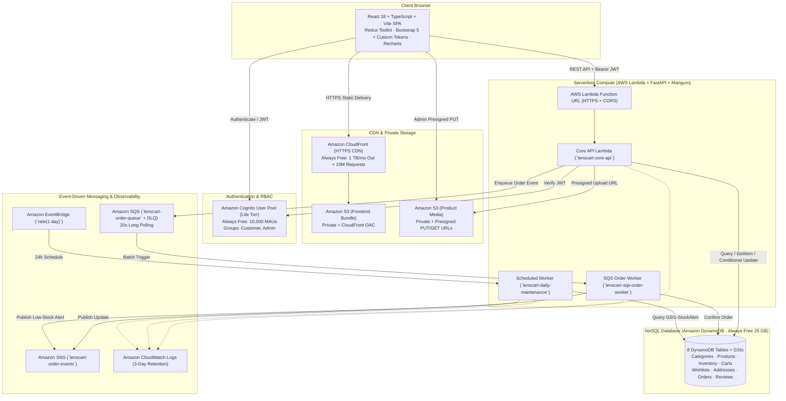

# LensCart — Photography Equipment & Accessories E-Commerce Platform

A full-stack, serverless photography and cinema equipment e-commerce store built with **React 18, TypeScript, Vite, Redux Toolkit, Python FastAPI, Amazon DynamoDB, Amazon Cognito, AWS Lambda Function URLs, S3, SQS, SNS, and EventBridge**—strictly engineered for the **AWS Free Account Plan**.

---

## Architecture Diagram



---

## Key Features

### Customer Storefront
- **Home Page:** Editorial hero showcase, 8 photography equipment categories, featured gear, best sellers, new arrivals, and special factory rebates.
- **Equipment Catalogue:** Search by keyword/SKU, filter by category, brand, optical mount (`Sony E`, `Canon RF`, `Nikon Z`, `Fujifilm X`, `Universal`), price range, rating, stock availability, and sorting (`popularity`, `price_asc`, `price_desc`, `rating`, `newest`) with pagination.
- **Product Details:** Multi-image gallery, category-specific technical specifications table, warranty & in-the-box details, live stock indicator, verified customer reviews, and compatible gear recommendations.
- **Camera & Lens Compatibility Checker:** Select any camera body to query DynamoDB `GSI3-LensMount` for 100% native-mount lenses and verified accessories.
- **Side-by-Side Specification Comparator:** Compare up to 4 cameras, lenses, tripods, or lighting units across aligned technical specifications.
- **Persistent Cart, Wishlist & Checkout:** Live server-side stock and price validation, wishlist-to-cart transfers, saved delivery addresses, idempotent order creation, and simulated payment (`SIMULATED_CARD`, `SIMULATED_UPI`, `SIMULATED_NETBANKING`).
- **Order Tracking & Cancellation:** Visual 6-stage order fulfillment progress bar (`Placed -> Confirmed -> Processing -> Packed -> Shipped -> Delivered`), full activity audit timeline, and atomic stock restoration upon cancellation.

### Administrator Portal (`/admin`)
- **Operations & Telemetry Dashboard:** Total revenue, total orders, pending fulfillment count, low-stock SKU alerts, recent orders, and interactive **Recharts** visualizations.
- **Product & Specification Management:** Create, edit, and deactivate products, manage category specifications, and generate restricted **S3 Presigned PUT URLs** (`<= 5 MB`, `image/jpeg`, `image/png`, `image/webp`).
- **Inventory Management:** Real-time available vs. reserved stock ledger, manual stock adjustments (`+/- delta`) with mandatory audit reasons, low-stock filter (`GSI1-StockAlert`), and movement history logs.
- **Order Fulfillment:** Filter orders by status or customer search, transition order statuses (`Confirmed`, `Processing`, `Packed`, `Shipped`, `Delivered`, `Cancelled`), and trigger SNS notifications.
- **Customer Directory:** Inspect Cognito customer accounts, order counts, lifetime value, and manage account status (`ACTIVE` / `SUSPENDED`).

---

## Seeded Evaluation Accounts

| Role | Email | Password | Capabilities |
| :--- | :--- | :--- | :--- |
| **Customer** | `elena.vance@lenscart.store` | `Customer@Lens2026` | Browse, compare, check compatibility, cart, wishlist, checkout, cancel orders, write reviews |
| **Admin** | `admin@lenscart.store` | `Admin@Lens2026` | Full access to `/admin` dashboard, product CRUD, S3 presigned uploads, inventory adjustments, order & customer management |

---

## Local Development Instructions

### 1. Start the Backend (FastAPI + Local Moto DynamoDB/S3/SQS/SNS Emulation)
```powershell
cd d:\PROJECTS\lenscart\backend
python -m pip install -r requirements.txt
python -m uvicorn app.main:app --host 127.0.0.1 --port 8000 --reload
```
- API Server: `http://127.0.0.1:8000`
- Interactive OpenAPI Docs: `http://127.0.0.1:8000/docs`

### 2. Start the Frontend (React + TypeScript + Vite)
```powershell
cd d:\PROJECTS\lenscart\frontend
npm.cmd install
npm.cmd run dev
```
- Web Application: `http://localhost:5173`

### 3. Run the Automated Test Suites
```powershell
# Backend Unit, Integration, RBAC, Customer Isolation & Inventory Consistency Tests
cd d:\PROJECTS\lenscart\backend
python -m pytest -v

# Frontend Component & Redux State Tests
cd d:\PROJECTS\lenscart\frontend
npm.cmd test
```

---

## Documentation Index
- [System Architecture & AWS Integration](file:///d:/PROJECTS/lenscart/docs/ARCHITECTURE_AND_DESIGN.md)
- [DynamoDB Database Design & GSI Access Patterns](file:///d:/PROJECTS/lenscart/docs/DATABASE_DESIGN.md)
- [REST API Contract & Environment Variables](file:///d:/PROJECTS/lenscart/docs/API_REFERENCE.md)
- [AWS SAM Deployment & Free Tier Cost-Control Guide](file:///d:/PROJECTS/lenscart/docs/AWS_DEPLOYMENT_AND_FREE_TIER_GUIDE.md)

